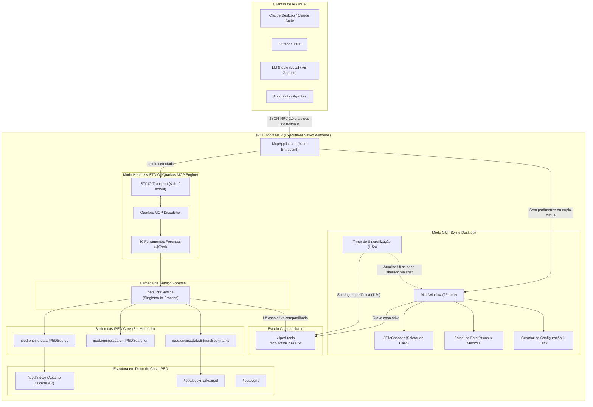
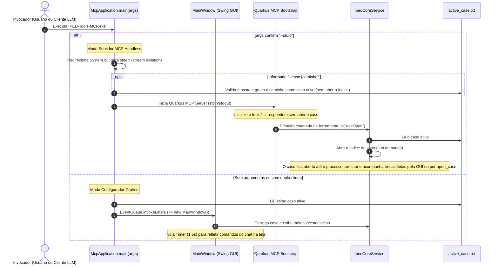

# Arquitetura e Fluxo de Execução

O **IPED Tools MCP** é construído sobre o ecossistema **Java 21 (LTS)** e **Quarkus 3.x**, operando como um processo nativo do Windows que integra diretamente as bibliotecas internas do IPED Core e do Apache Lucene sem intermediários de rede.

---

## 🏛 Diagrama de Arquitetura do Sistema

---

## 🔄 Fluxo de Vida e Execução em Modo Duplo (Dual-Mode)

O ponto de entrada `McpApplication.main(args)` inspeciona os argumentos de execução e roteia o ciclo de vida da aplicação:

---

## 💻 Opções de Linha de Comando (CLI)

O executável nativo suporta os seguintes parâmetros formais:

| Parâmetro | Descrição | Comportamento Operacional |
|---|---|---|
| `--stdio` | Inicia o servidor em modo STDIO MCP. | Desativa a interface gráfica, isola o fluxo `stdout` para JSON-RPC e aguarda requisições na entrada padrão. |
| `--case <caminho>` | Especifica um caso IPED na inicialização. | Opcional. A pasta é validada e gravada como caso ativo em `~/.iped-tools-mcp/active_case.txt`; o índice só é aberto na primeira chamada de ferramenta. Quando omitido, o servidor usa o caso já salvo nesse arquivo. |
| `--version`, `-v` | Exibe os dados de versão e licença. | Imprime versão, data do build, runtime Java e versão do IPED Core na saída padrão e finaliza imediatamente com código 0. |
| `--help`, `-h` | Exibe a ajuda da linha de comando. | Lista todos os parâmetros suportados com exemplos de uso. |

---

## 🩺 Logs e Diagnóstico

O pacote `br.com.ipedtools.mcp.diagnostics` cuida do registro para suporte:

| Classe | Papel |
|---|---|
| `LogFiles` | Grava o log em `%USERPROFILE%\.iped-tools-mcp\logs\`, um arquivo por modo (`iped-tools-mcp-stdio.log` e `iped-tools-mcp-gui.log`). Faz rotação a cada 5 MB, guardando 5 arquivos. Usa UTF-8, gravação imediata e o PID em cada linha. O handler é instalado no logger raiz no início do `main` e continua ativo depois que o Quarkus configura o log. O log em arquivo do próprio Quarkus não é usado, porque ele repassa os eventos anteriores à sua configuração e duplicaria as linhas de início. O handler grava a partir do nível INFO. Se a pasta não puder ser gravada, o log segue só no `stderr`. |
| `StartupDiagnostics` | Cabeçalho de cada início: versões, modo, argumentos, codificações, caso ativo, `iped.root`, `java.library.path` e as pastas do PATH ligadas a Python, JEP ou IPED, com as DLLs encontradas. |
| `ShutdownLog` | Registra o encerramento do servidor STDIO pelo `ShutdownEvent` do Quarkus, que roda antes de o log ser encerrado. |
| `CrashDiagnostics` | Registra exceções não capturadas e, no configurador, o encerramento. Copia para a pasta de logs os `hs_err_pid*.log` que a JVM deixou na pasta temporária, até 5 por início e sem repetir os já coletados. |

Outros pontos:
* **Etapas da abertura do caso** (`IpedCoreService.caseStep`): cada etapa registra início e fim, com duração. Uma falha fica registrada como `last_error`, devolvido por `get_server_status`.
* **Log do IPED:** as classes do IPED que usam a API log4j2 passam pela ponte `log4j2-jboss-logmanager` e chegam aos mesmos destinos. O `log4j-core` não faz parte do pacote.
* **Conteúdo do caso fica fora do log:** o MCP não registra texto de consultas nem valores devolvidos. A categoria `iped.engine.search.SimilarDocumentSearch`, que registraria os termos do documento de referência, fica em nível WARN no `application.properties`.
